As another fall in the northern hemispheres winds towards the solstice, it must be time
for another edition of KubeCon. I am grateful to return once again to the bi-annual gathering
of open source enthusiasts, professsionals, and media who follow the Kubernetes community.
This time we come back to Salt Lake City, where we had clear weather throughout the week, fewer
people than in Amsterdam, continued AI fatigue, and far too many intriguing hallways tracks.

KubeCon was held at the Salt Palace in Salt Lake City Utah this year, this is the same venue
we were at in 2024.
Again my schedule was packed starting on Sunday with the Maintainer Summit, then volunteering
at Red Hat's OpenShift Commons on Monday, followed by the full show from Tuesday through Thursday.
I have recently been elected to the Kubernetes Steering Committee, so in addition to the panel
I was part of for SIG Cloud Provider, I was also going to be part of two Ask Me Anything panels
for the committee. As usual by the end of the week I was exhausted, but I was also left
intoxicated by the familiar drug of intellectual and emotional excitement that only come
from interacting with truly excellent people.

The political world continues to provide more excitement than a 1980s Hollywood action show,
and this year did not disappoint. There was much talk about the recent election results in the
United States around the conference and local nightlife, even still the attendance numbers in Salt Lake
City felt much lower than Amsterdam earlier this year. The exhibitor hall felt _spacious_
while walking around, but the presentations were well attended from what I could gather.

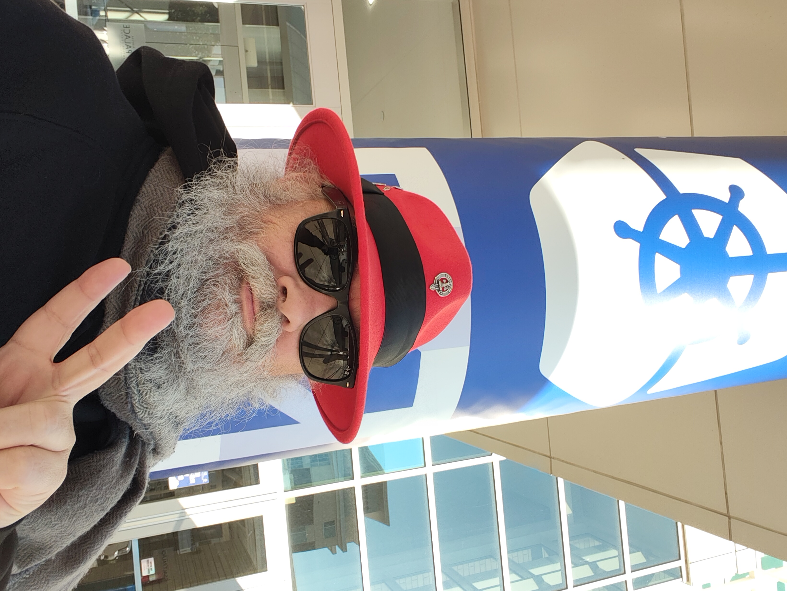
[A suspiciously similar selfie...](/2024/11/19/kubecon-na-2024-retrospective.html)

## Kubernetes Maintainer Summit, Sunday November 8

It should be no secret by now that the Kubernetes Maintainer Summit is my absolute
favorite day of KubeCon. What I love about the summit is that it continues some of the
best open source community traditions we have. There is a buzz in the air that I
associate with the gatherings that I prefer the most: namely, software development focused
discussions with a group that loves to dive into the details. I always have a good
time at these events, and I try to soak up as much as possible.

Something that I don't normally advertise is that I'm not overly fond of the KubeCon keynote
addresses. Unless I know the speaker or have a
strong connection to the topic, I usually don't attend them. But at maintainer summit, I am there
15 minutes before they start. This year, the keynotes for summit focused on the future of
our projects and how we can maintain our project health in the years to come.

There were many good points from the keynotes and morning sessions, and I loved the focus on
community and project health. Some of the ideas that stuck with me:
* **Project Maturity**. How can we build project environments that promote advancement and
  encourage new contributors to join and graduate through the community. Having clear guides
  about how to be successful in an open source project community will help the next generations.
  Also having strong plans for survivability, vendor neutrality, and security reviews build
  foundational strength in a project.
* **Leadership Graduation**. One of the most difficult things to do in an open source community
  is to step down from a leadership position. As the Kubernetes project ages, and its contributors
  also age, it is important for us to be reflective about how we raise and support our leaders.
  A healthy open source project has good support mechanisms around its leadership and also clear
  guides for how the community trains and selects new leaders. This is an area where the Kubernetes
  project has made advancements, but could do more work.
* **Source Code Is Not Enough**. Open source projects are so much more than just the source code.
  In ages past, it may have been enough to distribute some source code and a handful of archaic
  scripts for building. These days though, the strongest open source projects have entire
  community support structures that create documentation, user guides, video tutorials, installers,
  maintainance scripts, and the list goes on. Learning how to recognize opportunities for a wide
  diversity of collaboration takes effort, but the payoff is worth that effort.

After the keynotes and one morning session, it was time for my very first Kubernetes Steering Committee
Ask Me Anything panel.

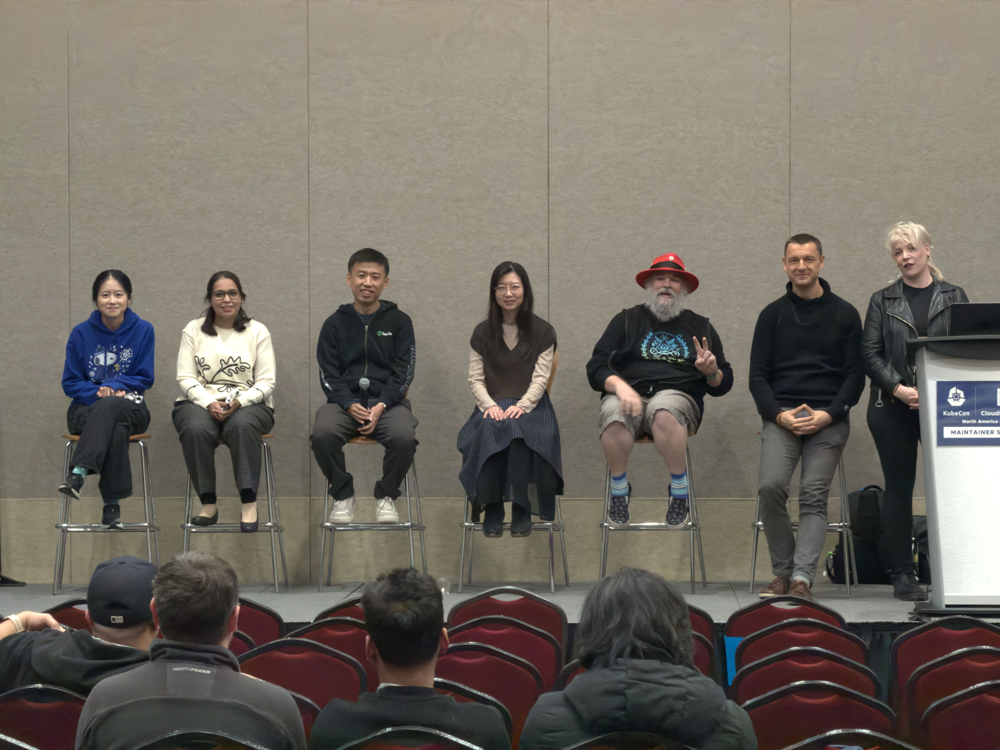
Kubernetes Steering Committee @ Maintainer Summit

I was a little nervous and anxious going in, but the other members of the committee (especially the
returning members Kat, Maciej, Paco, and Rita), were welcoming and congratulatory for all the
newly elected members. I joined the committee in the latest round of elections and it is a tremendous
honor for me to serve the community in this role. I was, and am, deeply thankful for all the people
who took the time to congratulate me and share their kind words. For those not familiar with the
steering committee, here is a brief summary from
[the charter][the-charter]:

> The Kubernetes Steering Committee is the governing body of the Kubernetes project, providing
> decision-making and oversight pertaining to the Kubernetes project bylaws, sub-organizations, and
> financial planning. The Steering Committee also defines the project values and structure.

I was told that this was the first time the entire seven member committee had met for a panel
at the maintainer summit. Given the committee's global span, it felt nice to think of all the
effort that went into having us together. We had
many great questions from the other maintainers and it was a nice mix of AI-related topics and
also curiosity for how the committee would like to steer the community for the future. I'm excited
to see how the next two years of my term will go, things are already moving quite quickly and
I hope I can have a positive impact on the project.

After the steering AMA, I went to several of the unconference sessions and tried to spend as much
time in the hallway track as I could. One session that stood out to me was the discussion on
how to handle the increase in pull requests and issues due to AI usage. This was also a popular
topic in Amsterdam and I was happy to see the community continuing to iterate on the ideas of
building trust among contributors and strong support from the steering committee regarding
maintainer health and safety. The community as a whole is facing tremendous pressure from new
activity, and learning how to effectively triage and prioritize that stream is an important topic.
The advances we are making as a community will help forge a new path for open source
software development in the era of agentic software lifecycles.

The event organizers had done a near perfect, in my mind, job planning the one day we had and I loved
to see the culmination of suggestions and feedback making their way into our activities. We once again
had hot lunches (yay!), and there was more time for networking and unconference sessions. I felt
full and contented by the end of the day (and we hadn't even had the party yet!). I know that many
of our colleagues and peers could not attend this summit. My heart goes out to them, and I hope
that we may meet in fairer waters in the future. I never fail to walk away from a maintainers summit
feeling humbled, I always hear that phrase about _"if you are the smartest person in the room ..."_ going
through my head. I look around at the intelligent, funny, compassionate, hardworking group that
represents our community and I can only feel grateful at being in that room.

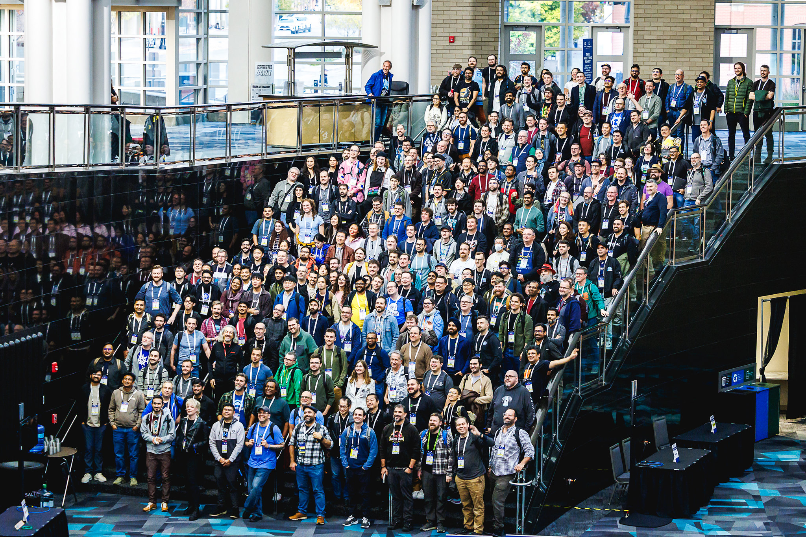
Maintainer Summit group photo CC BY-NC-ND 4.0 ([source][group-photo])

[the-charter]: https://github.com/kubernetes/steering/blob/main/charter.md
[group-photo]: https://www.flickr.com/photos/143247548@N03/55647622608/in/album-72177720336354173

## OpenShift Commons, Monday November 9

When I was planning my trip to KubeCon I was torn about what to do on Monday. Historically, OpenShift Commons
happens on the day before KubeCon with the other co-located events. Similar to Amsterdam though, there
was a Scheduler Driven Autoscaling Summit happening this day as well. I have been involved in the design
changes that are happening in autoscaling and scheduling since they started in the community and I was
keenly interested in participating again. But, I also love getting the chance to spend time with other
Red Hatters and with our customers and end-users. It was a tough choice for me to skip the design summit,
but these days I'm feeling it's more important for me to make space for others in the community, and I
knew I would have a chance to catch up on their work.

With that decision made months ago, I was on my way to OpenShift Commons.

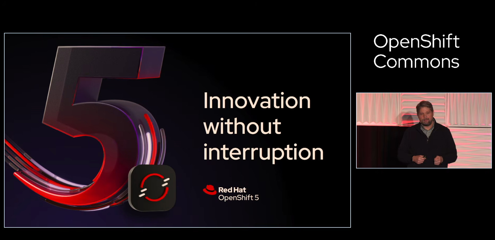
Mike Barrett announcing OpenShift 5

The big announcement for commons this year was [the release of OpenShift 5][openshift-5]. OpenShift is
the Kubernetes-based platform that Red Hat sells support for, and that I work on with my _downstream_ hat
on. This release is a huge milestone for Red Hat and I was proud to be part of the release and supporting
our on-site associates who were giving workshops and presentations. The most active part of my day was
actually during lunch when I participated in the "Ask the Experts" event. This is a chance for attendees
to sit with Red Hatters and talk. I met some really nice people and learned about how they are using
Kubernetes and what excites them about technology in general.

During the day, some of our media people approached me to make a little snippet for some OpenShift 5
material they are creating. They had me do a little gesture with my hand and making a _high five_, I'm
really curios to see if this makes it into our marketing stuff. They did manage to catch me chatting
with some hatters at the OpenShift party though. XD

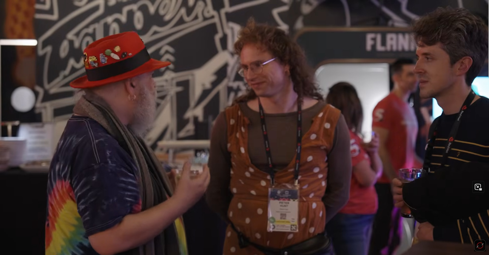
[source](https://www.youtube.com/watch?v=DgS5lB92JMo)

[openshift-5]: https://www.redhat.com/en/about/press-releases/red-hat-openshift-5-transforms-hybrid-cloud-operations-real-time-intelligence-and-zero-trust-security

## KubeCon Day 1, Tuesday November 10

Alright, the first day of KubeCon proper. I had a few talks scoped out that I wanted to see, but
the biggest thing on my mind was the second Steering Committee AMA panel that would be after
the keynotes.

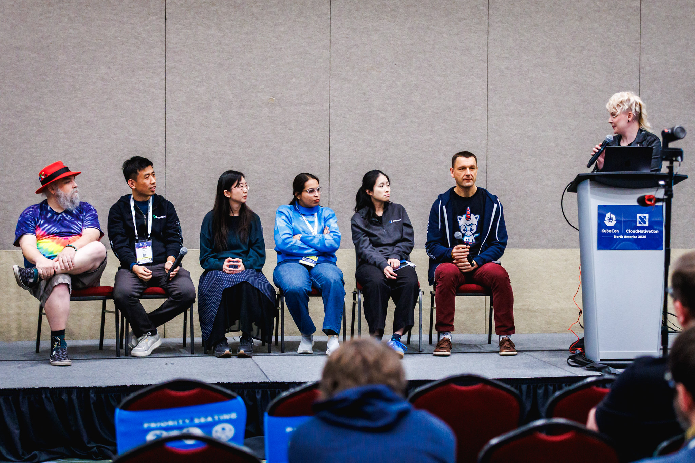
Kubernetes Steering Committee @ KubeCon CC BY-NC-ND 4.0 ([source](https://www.flickr.com/photos/143247548@N03/55656378306/in/album-72177720336408231))

The steering panel at KubeCon had similar attendance numbers as for the maintainer summit, and some of the same topics
came up as well. There were questions about the AI policy and what changes might be coming with respect to
the CVE-pocalypse we are currently experiencing. But, there were also many questions about community health
and how the steering committee is aligning around promoting healthier environments for all collaborators. The
health theme echoed some of things that came up during the maintainer summit, and I'm happy to see our
community so invested in ensuring that the people collaborating on our projects have the tools they need, and
the protection they deserve, to be as effective as possible.

After the steering panel, there was a talk in the demo theatre that I really wanted to see about using
agentic workflows with Karpenter.
I spend a lot of time working on Kubernetes autoscaling solutions, and the
[Karpenter project](https://github.com/kubernetes-sigs/karpenter) is very popular currently. This presentation
by Vikram Seshadri was titled
[Using kagent + Claude to Tune Your Autoscaling](https://events.linuxfoundation.org/kubecon-cloudnativecon-north-america/program/schedule/?id=1362466)
and although I don't spend much time interacting with agentic workflows, I was curious to see what Vikram was doing
with Karpenter.

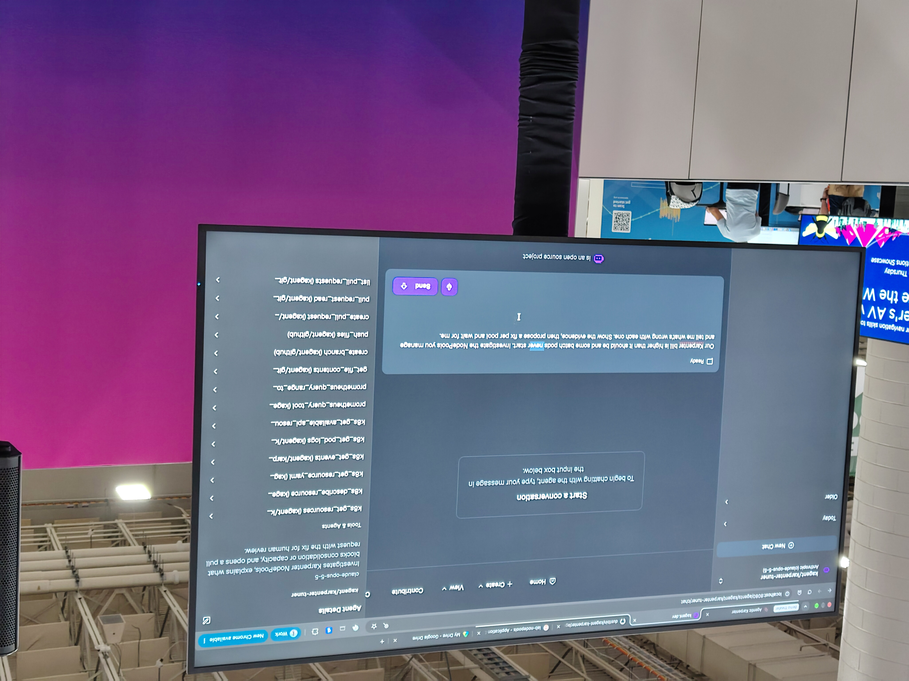

The screenshot above shows Vikram asking his agents the following:

> Our Karpenter bill is higher than it should be and some batch pods never start. Investigate the NodePools you manage and tell me what's wrong with each one. Show the evidence, then propose a fix per pool and wait for me.

What followed was a demonstration of how Vikram is using his agents to find answers about why his Karpenter
is not reacting to workflows, why it is not using the instances he wanted, and what suggestions might make his
cluster cost less. It was a nice presentation, and shows the direction people are moving with respect to configuring
their autoscaling applications.

I was in the exhibitor hall after the demo theatre and was curious to see what was happening, so I took a
stroll around. There were some fantastic booths as always, a ton of cool projects in the project pavillion,
and lots of community to soak up. I did manage to find a communal sticker pile and left some of my own
supply as well. XD

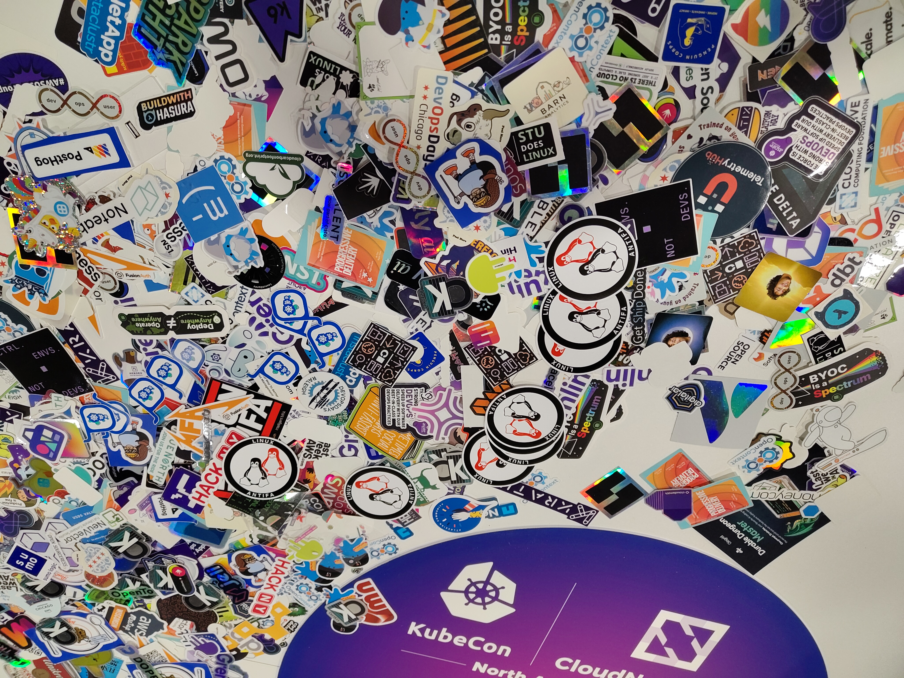

After catching my breath, and wandering around. I saw on Kubernetes slack that some of the SIG Autoscaling and
SIG Scheduling contributors were gathering to continue their discussions about scheduler driven autoscaling. I
knew this would be the perfect opportunity to catch up on what I missed Monday.

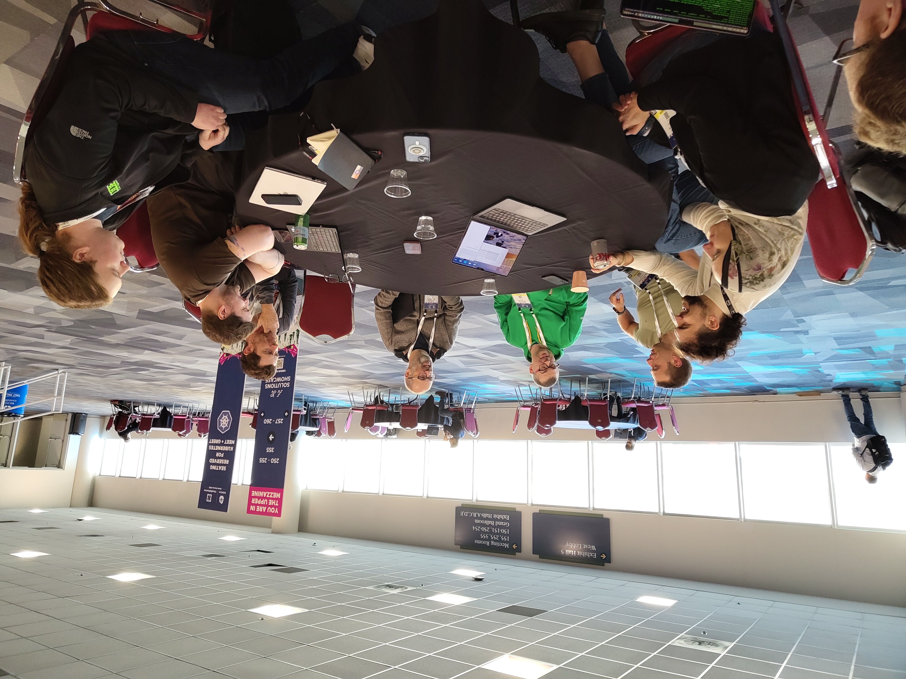
Epic hallway track with Kubernetes legends

As it turned out, some of the SIG Scheduling people had not been able to attend Monday's design summit either. So
this hallway track turned into a roughly two hour mini-design session where several core questions about
autoscaling and scheduling integration were answered. It was fascinating for me to see how
Kubernetes will be evolving and I have a feeling we will start to see enhancement proposals in the next few weeks
that will begin to expand scheduling options. Although I had planned to see other talks in the afternoon, like
a moth to a flame, I cannot resist an impromptu face-to-face design session with my peers. It was envigorating
to see so much excitement for the project and the future.

## KubeCon Day 2, Wednesday November 11

The second day of KubeCon was another big day for me as I had the SIG Meet and Greet and then the SIG
Cloud Provider panel afterwards. I spent the morning preparing for our panel and also reviewing a few
pull requests that had come up earlier in the week that needed attention. The cadence of software
development really changes during these long conferences. Many of the core maintainers are focused on the
daily life of the conference activities, and so the public face of open source development also slows down.
But, while the community of open source developers may slow down, the pace of corporate enterprise does not
and it is frequent to see people _secreting_ themselves away to the quiet corners of the conference space
to sneak in their duties.

But then it was time for lunch, and the SIG Meet and Greet.

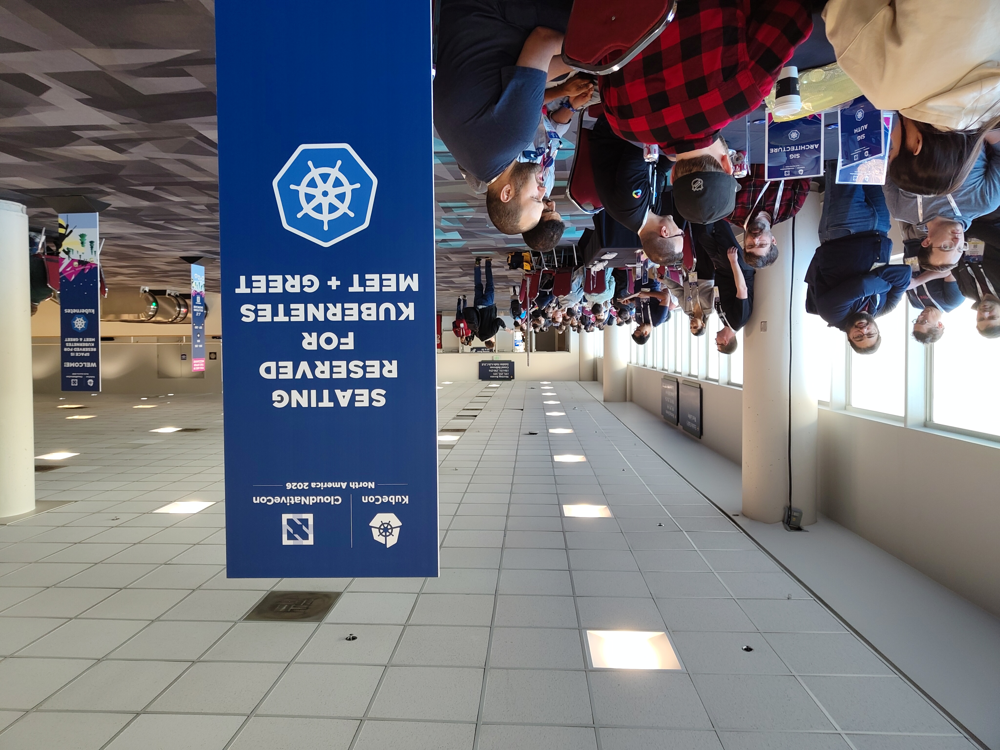

Even though the location was challenging to find in the Salt Palace, there was a nice crowd that showed
up for the meet and greet. I stayed for the entire two hours and saw most tables full of people having
conversations as well as good foot traffic. I ended up having two very different conversations with community
members, one about cluster autoscaler interactions with cluster api and scaling from zero in dynamic resource
environments, and the other about the mysteries of API versioning with the 
[kubernetes resource orchestrator project](https://github.com/kubernetes-sigs/kro)
. It felt great to have such interesting and open conversations across the hours I was there, this is
another aspect of what I love about healthy open source communities: the collaboration and sharing that
takes place.

I couldn't stay for long after the meet and greet as our SIG Cloud Provider panel was starting in just under
thirty minutes. I booked it across the conference and prepared for our panel
[Achieving Cross-Cloud Portability with the Kubernetes Resource Orchestrator](https://www.youtube.com/watch?v=GP8mYv_5Plc)

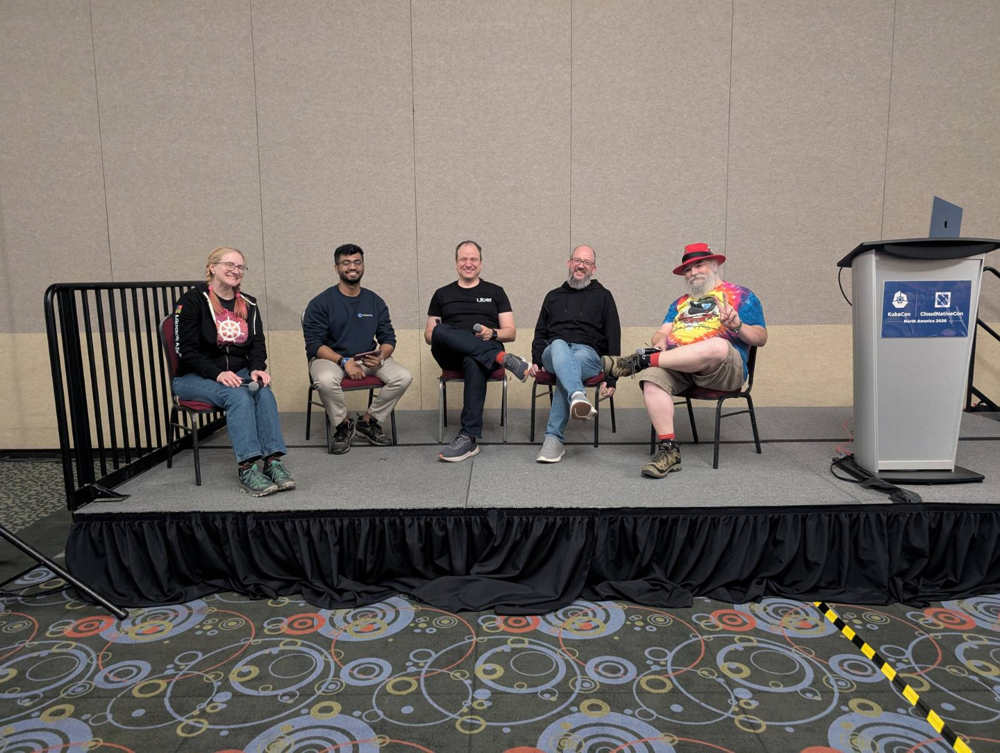
Bridget, Sitesh, Daniel, Jesse, and me

We had a nice size audience for the panel, and our newer community members Daniel Bruno and Sitesh Pattanaik
really shined with their kro expertise. During the panel, Daniel and Sitesh demonstrated how a single kro
manifest could be used to operate and lifecycle an entire AI pipeline across three different cloud providers.

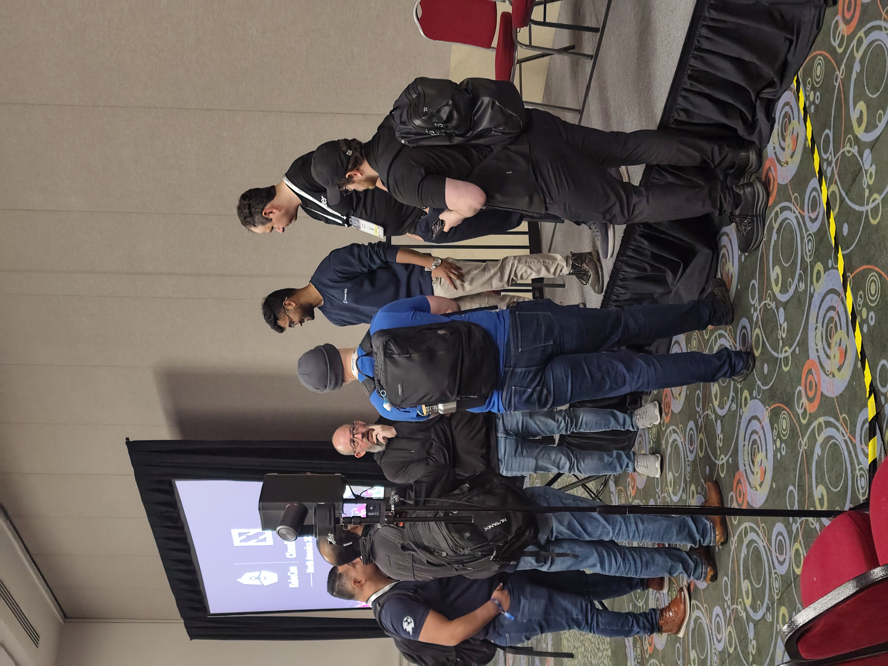

This was Daniel and Sitesh's first time presenting as part of a maintainer track as KubeCon. We were lucky
there was a coffee break after our panel as people stayed for well over 15 minutes to chat with Daniel, Jesse,
and Sitesh; a truly rewarding sign for a talk. Bridget and I are the co-chairs for SIG Cloud Provider and
we have been focusing our efforts on building the health and
future of our SIG. I know I can speak for both of us when I say that we were proud to see such a wide
cross-section of our community represented in this panel. I'm looking forward to a future SIG Cloud Provider
where we help lift our peers to the roles of leadership.

## KubeCon Day 3, Thursday November 12

The third day of KubeCon brought a very relaxed feeling for me. All my official duties were over and I could
view the conference from the perspective of a mind completely at ease. I spent the morning walking
around the exhibitor hall once more.

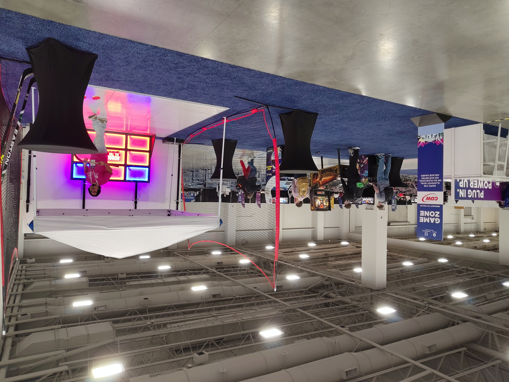

It's fun to see how the conference organizers plan various _non-work_ type activities. I've loved
seeing the curling games at previous KubeCons and this "Game Zone" was no different. They had some
cool videos games and a pinball machine, and that lit up thing on the right is a hockey challenge
game where you could launch pucks at the lighted squares. The conference was getting a little
empty by this point, but I had it in my mind to finish my last circuit.

I saw a couple presentations on Thursday, and one that stood out to me was Taahir Ahmed and Standa
Láznička's talk
[PKI Done Easy with Pod Certificates and Cluster Trust Bundles](https://www.youtube.com/watch?v=XpmhDoiNDIY).
I love a good security talk, especially on topics that I want to know better. For as long as I have
studied PKI, I always need a reference manual to make sure I don't screw it up. This was a cool talk
about how you can build better workload level trust in Kubernetes. Given the recent formation of the
[Node Identity Working Group](https://github.com/kubernetes/community/tree/main/wg-node-identity), I 
was keenly interested to see Taahir's talk, and to learn more about this pattern.

I spent the last few hours of my day seeing maintainer track talks and soaking up the hallway track until
there was nothing left...

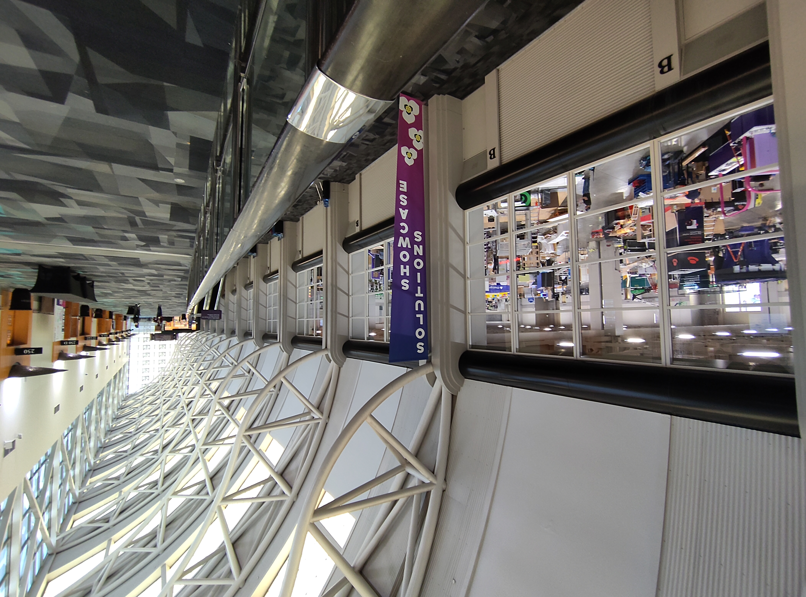

## AI at KubeCon

AI was a big topic again this year at KubeCon. Most of the keynotes and a majority of the talks seemed
to have some sort of AI-centric language in them. For me, the AI topics are starting to resolve into
a few categories:
* Agentic workflows, where discussion is focused on how to use agents for automating tasks and reducing
  toil. I don't often find these to be very novel, but they help with sharing knowledge about best
  practices and results when using agents.
* AI platforms and how to build them, these discussions are around how design platforms for reuse that
  can support AI infrastructure software. I find these discussions to be intriguing from the software
  development perspective, as they often involve understanding how workloads with very specific use
  patterns can be modeled and supported by infrastructure as a service.
* Hardware integrations, where the real-world problem of running workloads that require entire data
  centers worth of hardware coordination are debated, disected, and designed. I love love listening
  to these conversations, but find that I am growing too out of touch to be much use by involving
  myself in active participation. 

I'm sure I speak to a very biased subsection of the Kubernetes community, but I try to push my
boundaries and experience different perspectives. If you've read my thoughts
[In Support of Human Cognition](/in-support-of-human-cognition), then you know how I feel about
AI technology. I found it interesting once again to hear, however anecdotally, that people want more
technical talks and less AI-related talks. Even though there was observably lower attendance in
Salt Lake City, I still heard from many people who wanted to get away from the AI talks to see
more technically challenging topics. I suppose this trend will continue, but it's also nice
to see continued interest from the community in placing sensible guardrails around AI.

## Thoughts and takeaways

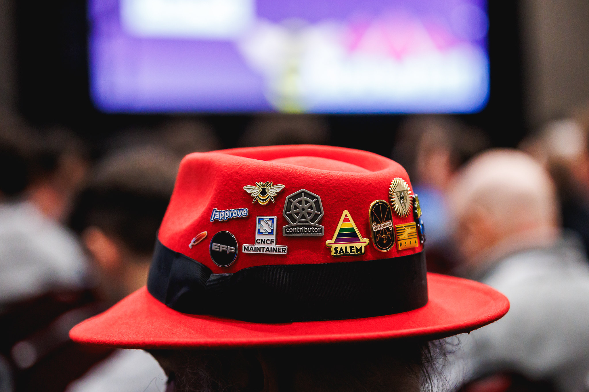
CC BY-NC-ND 4.0 ([source](https://www.flickr.com/photos/143247548@N03/55647677549/in/album-72177720336354173))

I had a wonderful time in Salt Lake City. I was sad that the attendance was lower, and that given the
state of the world many colleagues could not make the journey due to conscience or circumstance. Even
though I did attend, I will continue to stand with those who were not able to do so. I want us to do
better as a community in the future, and plan for venues where we can open our doors wider.

My hesitancy about AI usage has not abated, in fact I have been inspired by my fellows to be louder about
my thoughts. It is disturbing to me to see so many people rushing to implement technology that is
still under consideration for its efficacy and long-term effects. I am heartened to hear so many of my
colleagues echo these concerns. One thing that continues to inspire hope and optimism within me are
the people of the Kubernetes community. I can sense a genuine desire to build the best, safest, software
we can while also fully respecting the people who are building it. I want to continue to be a part of this
community, and do my best to promote our values.

Here are a couple final takeaways from the conference:
* In the next year we will see big changes in scheduling to allow for even more dynamic autoscaling workloads.
* Agentic AI workflows will continue to grow and gain traction as a primary interface for all sorts of computing systems.
* The Kubernetes community will enable more AI tooling to help relieve pressure on maintainers.
* The Kubernetes community will also define stronger guidelines to support maintainers and the health of the community.
* Personal AI models that can run on local hardware will continue to gain popularity in the software development community.

I think that brings me to the end of my retrospective on KubeCon Salt Lake City 2026. I must reiterate how thankful and
grateful I am for the opportunity to continue working on this technology and with this community. I'm honored to
have been elected to the steering committee, and I hope I live up to that trust. I was once again excited to attend KubeCon
and even a little hopeful after spending some quality time with my friends. Hopefully we can meet at a future
conference, perhaps even Barcelona. Until then, and as always, happy hacking!

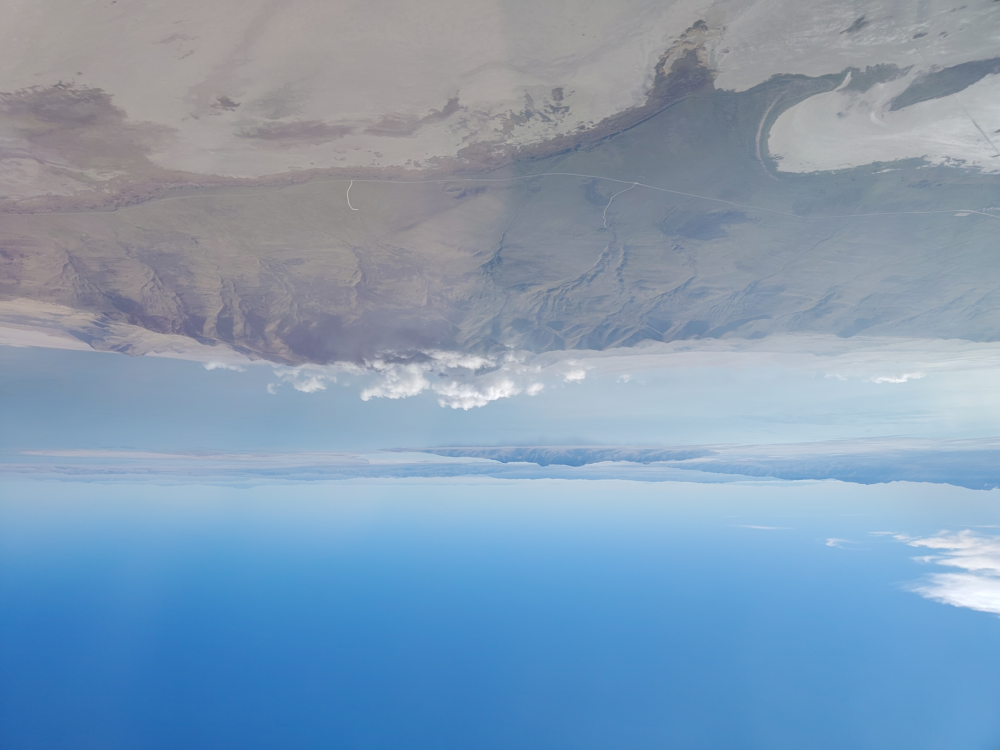
Great Salt Lake
